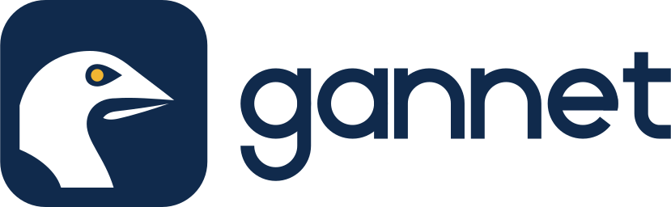

  <a href="https://gannet.dbhq.uk/">
    <picture>
      <source media="(prefers-color-scheme: dark)" srcset="assets/lockup-white.svg">
      
    </picture>
  </a>

# gannet

**[gannet.dbhq.uk](https://gannet.dbhq.uk/)** - what gannet is being built to
do, where the build stands, and guides on deep research, search APIs and
judging sources.

Deep research in C#. Give it a question and it plans the research, searches
the web, weighs each source, and writes a report in which every claim is
cited.

It is built on Microsoft Agent Framework: a planner, a searcher, a synthesiser
and a writer run as one workflow. It has a Blazor web UI, and you choose the
model (a cloud API or a local one through Ollama) and the search service. It
is self-hosted: you run it with your own keys, or with no keys at all on local
models and a search engine you host yourself.

## Where it stands

Started on 21 October 2026. The design is settled and the build is under
way: the solution, CI and repository files are in place. Nothing runs yet.
This section will say when there is something to run.

## Licence

MIT. See [`LICENSE`](LICENSE).
